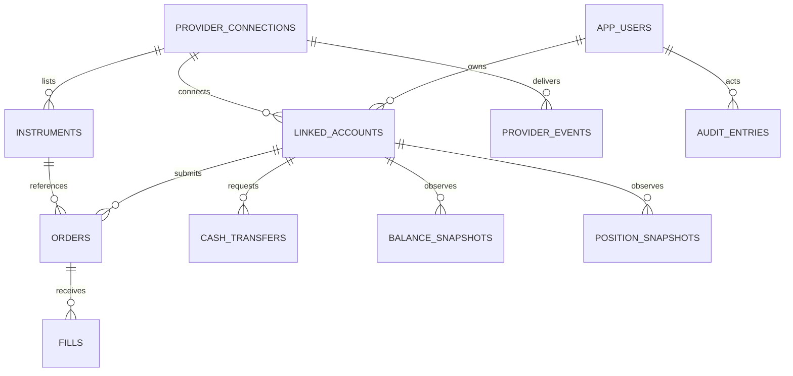

# 2일차 — 계정·거래·자금 데이터 모델

## 구현 범위

도메인 타입, 상태 전이 함수, Drizzle 스키마, 생성된 SQL, SQLite 제약 테스트까지 구현했다.
**아직 운영 DB에 연결하거나 데이터를 저장하는 API는 없다.** `.openai/hosting.json`의 D1은 null로 유지한다. SQL은 로컬 메모리 DB에 적용해 검증했으며 호스팅 DB에 적용하지 않는다. 4~5일차 인증/저장소 작업 때 바인딩을 활성화하고 최초 마이그레이션을 적용한다.

## 원본과 복제 기록

- 앱: 사용자 설정, 관심 시장, 주문 의도, 요청 식별자, 감사 기록의 원본.
- 파트너: 고객 거래 자격, 체결·보유량·잔액·입출금·결과 정산의 최종 원본.
- 로컬 거래 데이터: 파트너 사실을 대조하기 위한 복제 기록. 자체 고객자금 수탁 원장이 아니다.
- `cash_transfers.status = completed`만 보고 자체 잔액을 더하지 않는다. 파트너 자금 이벤트/잔액 스냅샷과 대조한다.
- 주문 표시용 누적 체결량과 개별 체결 내역은 대조해야 한다. SQL 제약만으로 체결량 합계 보존이 완성되는 것은 아니다.

## 테이블과 조회 경로

| 테이블               | 역할                                   | 주요 제약·조회                                         |
| -------------------- | -------------------------------------- | ------------------------------------------------------ |
| app_users            | 앱 사용자, 외부 인증 subject, 상태     | auth_subject 유일. 비밀번호/주민번호 저장 없음         |
| provider_connections | 거래소와 development/sandbox/live 연결 | provider_id + environment 유일. 승인은 기본 unapproved |
| linked_accounts      | 사용자와 파트너 계정 연결              | 외부 계정 중복 차단. 사용자 조회 인덱스                |
| instruments          | 거래소별 상품과 규칙 버전              | 같은 제목도 거래소가 다르면 다른 상품                  |
| orders               | 주문 의도와 최신 실행 상태             | 계정별 client_order_id 유일, request_hash 충돌 검사    |
| fills                | 개별 체결 사실                         | 연결·계정·external_fill_id 유일                        |
| cash_transfers       | 입출금 의도와 파트너 처리 상태         | 계정별 요청번호, 외부 전송번호 중복 차단               |
| balance_snapshots    | 파트너 잔액의 버전별 관측              | 계정 + revision 유일. 현금·거래가능·출금가능 별도      |
| position_snapshots   | 보유 계약과 예약 수량                  | 계정·시장·결과·revision 유일                           |
| provider_events      | 정규화 이벤트 수신함                   | 연결 + 외부 이벤트 ID 유일. 충돌은 격리                |
| audit_entries        | 주체·행동·대상·사유·추적번호           | 대상별 시간순 인덱스                                   |

## 계정 소유권

주문/입출금/포지션은 `(account_id, connection_id, user_id)`를 하나의 외래키로 연결한다. `user_id`만 같은 것처럼 꾸미거나 다른 거래소의 시장 ID를 섞으면 DB가 거부한다. 체결도 해당 주문의 계정·연결과 일치해야 한다.
이 제약은 인증을 대체하지 않는다. 후속 API는 actorUserId를 요청 본문에서 받지 않고 서버 세션에서 얻어야 한다. 계정 열람도 소유자 조건을 반드시 적용한다.

## 금액·수량 단위

현재 상품 범위는 USD, 정수 계약, 1센트 호가이다. 계산과 저장은 정수 센트로 한다. API 가격 범위 1~99¢, 주문 수량 1~10,000. JavaScript 안전 정수 범위를 SQL에서도 확인한다.
소수 계약·1센트 미만 호가의 파트너와 제휴하면 별도 스케일/반올림 명세를 만든 뒤 타입과 저장소를 확장한다. 현재 값으로 강제 반올림하지 않는다.
수수료 음수는 파트너 리베이트일 수 있다. 실제 현금 잔액도 반환/정정으로 음수가 될 수 있어 원본 값을 보존한다. 거래 가능·출금 가능 한도는 현금에서 자체 추측하지 않는다.

## 중복과 순서

- 주문 요청: 계정 + client_order_id, 입력 정규화 후 request_hash. 같은 키/다른 본문은 409 처리 예정.
- 체결: 연결 + 계정 + 외부 체결 ID. 재수신해도 계약/현금에 다시 적용하지 않는다.
- 이벤트: 연결 + 외부 이벤트 ID. 파트너 ID가 계정 범위라면 어댑터가 계정 ID를 포함한 키로 정규화한다.
- revision: **서버 도착 순서가 아니라 해당 객체의 권위 있는 파트너 상태 순서**. 순번 없는 업체는 최종 조회와 직렬화된 정규화 절차가 필요하다.
- 같은 revision에서 내용이 다르면 재시도로 덮지 않고 조사한다. 오래된 스냅샷을 무시하더라도 체결/정정 이벤트 자체를 버리면 안 된다.

## 원자적 쓰기 계약 — 후속 저장소 구현 사항

1. 외부 이벤트 ID와 payload 해시를 확인한다.
2. 새로운 체결 사실을 삽입하고 상태 전이 함수를 계산한다.
3. 누적 체결량/포지션·잔액 대조 결과와 감사 항목을 동일 트랜잭션/원자적 batch로 저장한다.
4. 모든 쓰기가 성공한 뒤 이벤트를 applied로 처리한다. 충돌은 quarantined로 남긴다.
5. 동시 처리에는 기존 revision을 조건으로 한 비교 후 갱신(CAS)을 사용한다. 실패하면 재조회한다.

SQLite 테스트는 제약 위반 시 체결 기록과 주문 상태를 함께 롤백할 수 있음을 확인한다. 실제 D1 prepared statements + batch 저장소와 CAS/재시도는 아직 구현 전이다.

## 보존·정정

금융 기록은 일반 UI에서 삭제하지 않는다. 외래키 삭제는 restrict다. 감사/체결의 append-only 쓰기와 보관 정책은 저장소 계층에서 별도로 강제해야 한다. DB 스키마만으로 수정 불가능성을 보장하지 않는다.
체결 취소(bust), 정정, 결과 재판정은 원기록 삭제 대신 별도의 정정 이벤트를 요구한다. 오늘 구현은 자동 반영 대신 명시적으로 오류를 내며 조사 대상으로 넘기는 토대다. 정정 저장·반영 워크플로는 실거래 전 필수다.

## 민감정보

비밀키, 계좌 비밀번호, 신분증, 원본 KYC 문서는 이 스키마에 넣지 않는다. provider_events에는 허용 필드만 남긴 정규화 payload를 저장한다. 원문이 필요하면 파트너 계약과 보안 저장 정책을 별도로 정한다.

## 실거래 활성화와의 관계

계정 정책 함수는 소유권·환경·앱 상태·파트너 계정 상태·본인 확인·파트너 권한만 검사하는 순수 함수다. 지역/상품별 자격, 연결 승인, 세션 인증, 이용자 동의, 수수료, 주문 한도, 시세 유효성은 후속 서버 흐름에서 추가 검증해야 한다.
**이 함수가 allowed를 반환해도 현재 주문 API는 계속 503이다.** DB의 approval을 approved로 바꿔도 실행 경로가 생기지 않는다.
