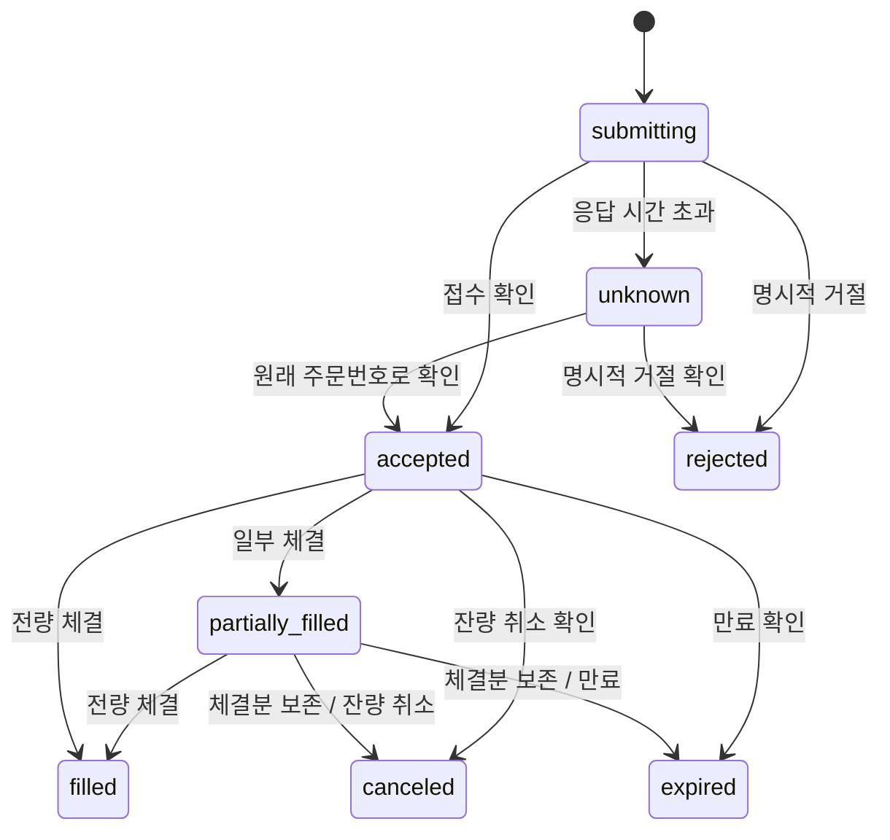
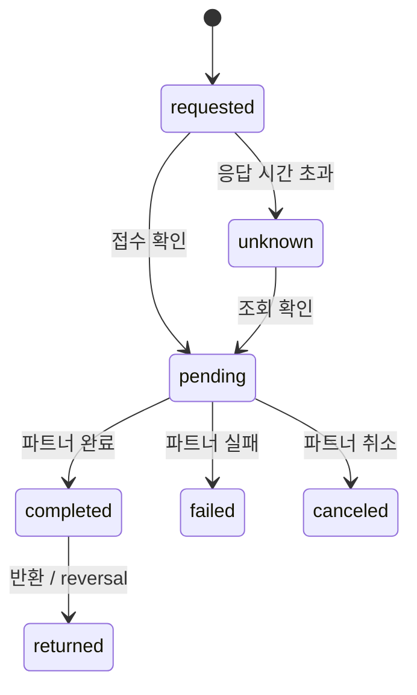

# 주문·입출금 상태 전이

## 주문

그림은 대표 경로다. 중간 알림이 유실되면 최초 상태에서도 권위 있는 filled/canceled/expired 최종 스냅샷으로 직접 이동할 수 있다.

- 실행 상태와 cancelRequested를 따로 저장한다. cancel_pending은 표시 상태다.
- 취소 요청은 주문이 사라졌다는 뜻이 아니다. 자금/계약 예약을 해제하지 않는다.
- 취소 요청 후 100개 전량 체결되면 filled가 된다. 취소 실패를 받으면 기존 accepted/partially_filled 상태를 표시한다.
- 취소 중 통신 오류는 명시적 취소 실패가 아니다. 대기 유지 후 재조회한다.
- canceled 상태에서도 늦은 확정 스냅샷이 기존 체결량을 늘릴 수 있다. 여전히 잔량 취소이며 개별 체결 내역과 대조해야 한다.
- 최종 상태를 다시 거래 중으로 바꾸거나 체결량을 줄이는 정정은 ReconciliationRequired로 처리한다. 자동 덮어쓰지 않는다.

| 입력                                          | 결과                           |
| --------------------------------------------- | ------------------------------ |
| 주문 제출 후 타임아웃                         | unknown; 같은 주문번호 조회    |
| 30개 체결 → 취소 요청 → 70개 체결 → 취소 확인 | 70개 체결 보존, 잔량 30개 취소 |
| 취소 요청 → 100개 체결                        | filled, cancelRequested=false  |
| revision 3 수신 후 revision 1                 | 상태 유지                      |
| 같은 revision, 같은 내용                      | 중복으로 상태 유지             |
| 같은 revision, 다른 내용                      | 대조 필요 오류                 |
| filled인데 수량이 주문량보다 작음             | 오류                           |

## 입출금

중간 알림을 놓친 경우 requested/unknown/pending에서 completed 또는 returned로 직접 이동할 수 있다. returned는 별도 상태이며 completed로 재진입하지 않는다. 정정이 필요하면 별도 조사/정정 이벤트를 작성한다.

상태 함수는 금액을 바꾸거나 잔액을 지급하지 않는다. 같은 completed 알림을 두 번 받아도 돈을 두 번 더하는 로직이 없도록 자금 원본과 표시 상태를 분리했다.

## 계정

- 앱 상태: active / suspended / closed.
- 거래소 계정: unlinked / pending / active / restricted / closed.
- 확인 상태: not_started / pending / verified / rejected.
- 본인 소유가 아니거나 연결/환경이 다르면 열람도 차단한다.
- 거래/출금은 앱 active, 거래소 active, verified, 파트너 해당 권한을 모두 요구한다.
- 제한/종료 계정의 기록 열람은 소유자에게 허용하지만, 자금 처리 요청은 별도로 판단한다. 실제 출금 제한/계정 종료 정책은 제휴 조건에 맞춰 조정한다.
